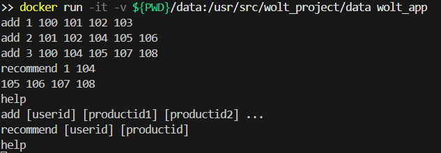

# Wolt

## About
A CLI application that manages user-product interactions 
and provides intelligent suggestions based on user behavior. 

## Commands
- `add [userid] [productid1] [productid2] ...` - Add products a user watched
- `recommend [userid] [productid]` - Get up to 10 product recommendations
- `help` - Print all available commands

## How to Run

### Run the full app (Server + Client)
```bash
docker-compose up --build
```

### Run the tests
```bash
docker-compose up --build tests
```

### Run the server only (for debugging)
```bash
docker-compose up --build server
```

### Stop the app
```bash
docker-compose down
```

## Example Run
```
add 1 100 101 102 103
add 2 101 102 104 105 106
add 3 100 104 105 107 108
recommend 1 104
#output
105 106 107 108
help
#output(the next 3 lines)
add [userid] [productid1] [productid2] ...
recommend [userid] [productid]
help
```
