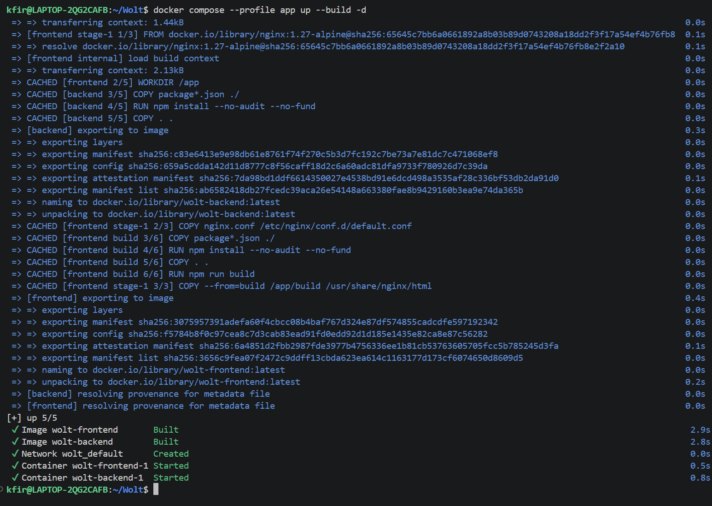
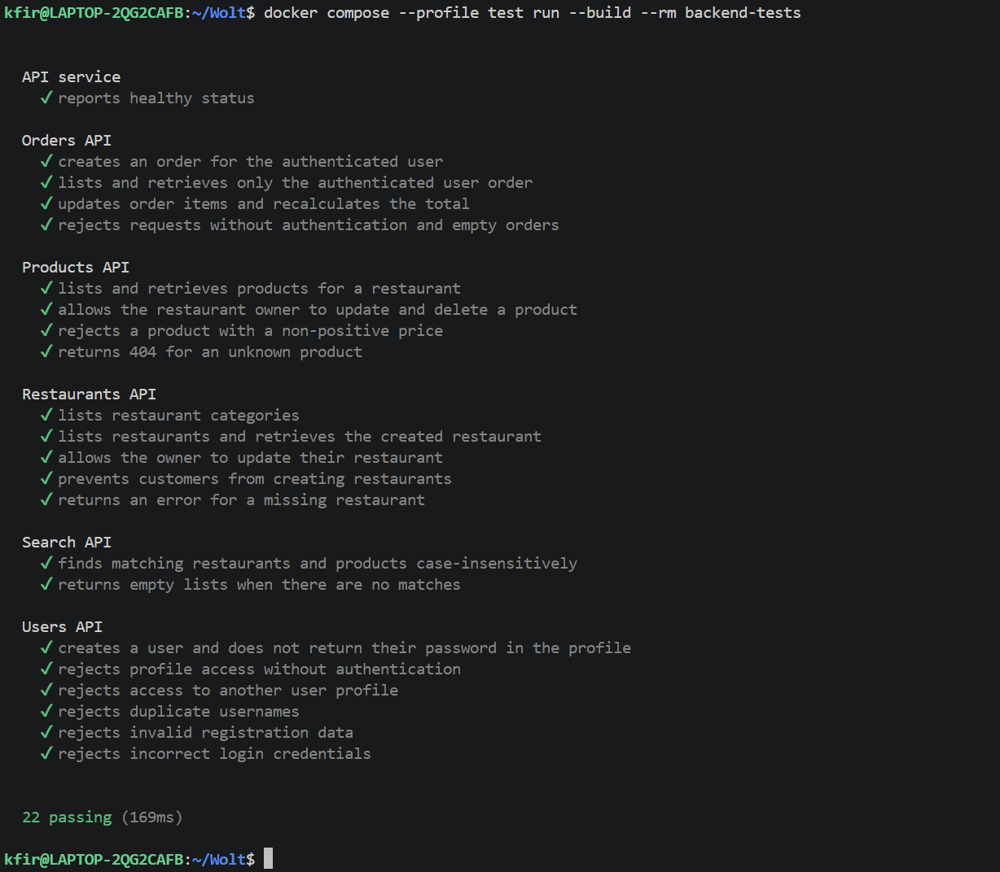
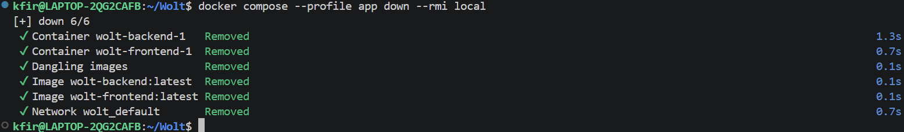

# Wolt -Web Application

This guide contains the six commands for running and removing the web application with Docker Compose. Run them from the repository root, where `docker-compose.yml` is located.

## Start Both Frontend and Backend

```sh
docker compose --profile app up --build -d
```



Builds the Frontend and Backend images if needed, then creates and starts both containers in the background.

- Frontend: <http://localhost:3001>
- Backend health check: <http://localhost:3000/api/health>

## Start Only the Backend

```sh
docker compose --profile backend up --build -d backend
```

Builds the Backend image if needed, then creates and starts the Backend container in the background. It does not stop a Frontend container that is already running.

## Start Only the Frontend

```sh
docker compose --profile frontend up --build -d frontend
```

Builds the Frontend image if needed, then creates and starts the Frontend container in the background. It does not stop a Backend container that is already running. Without the Backend, API-dependent features such as login, restaurants, and orders will not work.

## Run Backend Tests

```sh
docker compose --profile test run --build --rm backend-tests
```



Builds the test image if needed, runs the Backend test suite in a temporary container, and removes that container when the tests finish. This runs tests only; it does not start or stop the regular Backend or Frontend services. The tests use an in-memory database, so test data is discarded when the test process exits.

## Stop and Remove Both Services

```sh
docker compose --profile app down --rmi local
```



Stops and removes both application containers and the Compose network. `--rmi local` also removes the locally built Frontend and Backend images. It does not remove source files.

## Stop and Remove Only the Frontend

```sh
docker compose --profile frontend rm --stop --force frontend && docker image rm wolt-frontend:latest
```

Stops and removes the Frontend container, then removes its local Docker image. It leaves the Backend running.

## Stop and Remove Only the Backend

```sh
docker compose --profile backend rm --stop --force backend && docker image rm wolt-backend:latest
```

Stops and removes the Backend container, then removes its local Docker image. It leaves the Frontend running.

## Image and Container

An **image** is the built template used to create a service. A **container** is an instance of that image that Docker has created and can run.

The start commands use `up --build`: Docker builds or updates the image, then creates and starts the container. The remove commands delete the selected container and its image. If an image is still used by another container, Docker may refuse to remove that image until the other container is removed.

## Ports

The default ports are `3001` for the Frontend and `3000` for the Backend. To change them, edit `FRONTEND_PORT` or `BACKEND_PORT` in the root `.env` file. Since the Frontend image includes the Backend address at build time, run the relevant start command with `--build` after changing a port.

This Compose setup runs only the web application in `src/web`. It does not build or start the separate C++ recommendation server or TCP client.
