# Application flows

These screenshots were captured during checks on 15 and 16 October 2026. Mobile checks used Expo Go in BlueStacks; website checks used the browser. Both clients read the same Node API and MongoDB database within each environment. The first runs used local services; later runs used Docker Compose as described below. The account names and demonstration records shown here are fictional.

The images are original captures, copied without cropping or changing pixels. No mouse pointer is visible. The round settings button in the mobile captures belongs to BlueStacks. The screenshots record the stages described below; they are not a complete record of every screen in the final version.

See [Build and run](run.md) for startup and test commands, and [the walkthrough](README.md#application-walkthrough) for the application steps.

## Home and restaurant menu

The mobile home loads restaurant data, pictures and categories from the server. Selecting **Basil Pizza** opens its menu, including **Margherita Pizza** at ₪42.00. These two captures are from the end of part 2, before cart controls were added in part 3.

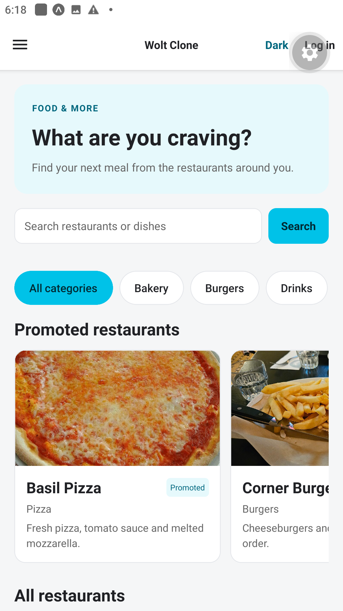

## Order shared between mobile and website

1. A signed-in customer added one Margherita Pizza from Basil Pizza and placed the order in the mobile app. The confirmation showed ₪42.00 and the cart became empty.
2. The same account opened the order details on the website. The item, price and order ID matched the mobile confirmation.
3. Quantity changes were saved during the check. The website showed two items at ₪84.00, and a later mobile history capture showed three items at ₪126.00. Refreshing the other client showed the updated server data.
4. The order was later deleted from mobile after testing Cancel and then confirming Delete. Both histories were checked and were empty. The images below were taken before this deletion. A separate Compose run below includes the refreshed history after deletion.

Mobile confirmation after placing the order:

The matching order on the website:

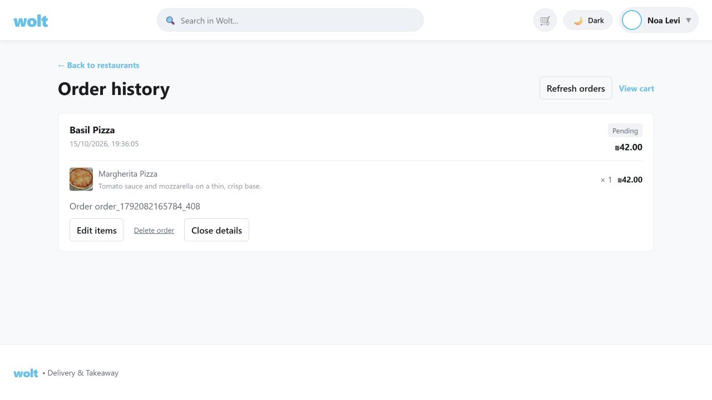

The website after a quantity update:

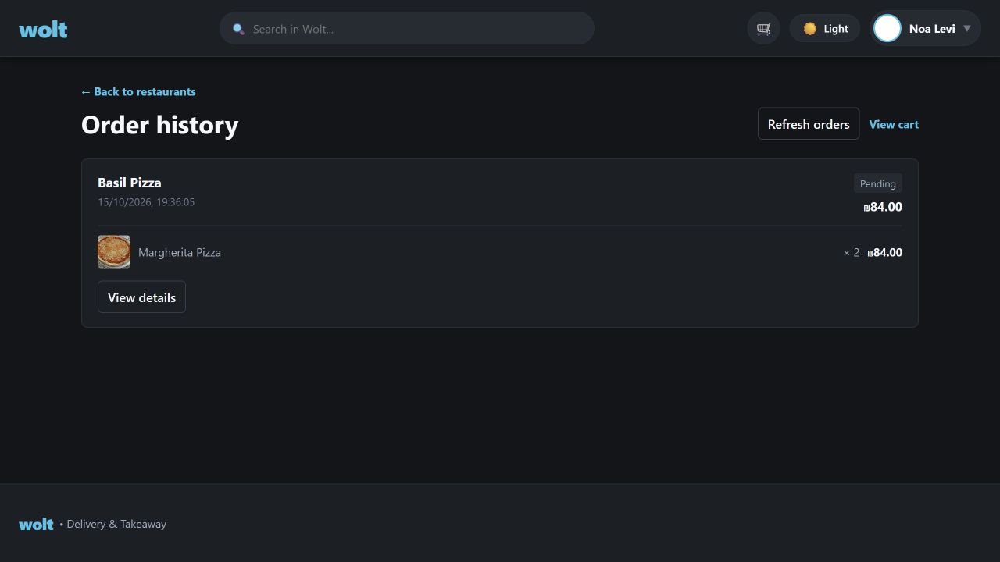

A later mobile history capture:

The light and dark captures also show both appearance modes. The pictures establish the displayed states; they do not identify which client initiated each quantity change.

## Restaurant owner flow

A restaurant owner created **Maple Cafe** in the mobile app. A project coffee picture was selected through the system's individual-photo chooser. Broad media access remained denied. After saving, the restaurant appeared in **My restaurants** with its picture and the **Edit** and **Manage menu** actions.

The name was then changed in mobile to **Maple Cafe and Bakery**. The website was checked and showed the updated name and an empty menu. The capture above is from before that rename. The dish captures below show the new name in both clients after a dish was added.

## Dish creation, editing and deletion

The owner opened **Manage menu** for Maple Cafe and Bakery and added **Cappuccino**, with a price of ₪18.00, category **Drinks** and a coffee picture. The picture was chosen through the individual-photo chooser while broad media access remained denied. After saving, the dish appeared in the mobile menu with its name, price, picture and **Edit Cappuccino** action. The category was entered during the check and is not displayed on this menu card.

The same restaurant was opened on the website. Opening **Dish details** fetched Cappuccino from the API and displayed its **Drinks** category, ₪18.00 price and coffee picture. This checks the website reading the dish created on mobile; it does not show creation from the website.

The owner edited the dish in mobile and changed the price from ₪18.00 to ₪20.00. After saving, **Manage menu** showed the new price and kept the coffee picture. Reloading the website also showed ₪20.00; the website image above was taken before this update.

The owner then tested **Delete** in the mobile edit form. Choosing **Cancel** kept the form open. Confirming deletion returned to **Manage menu**, which showed that the restaurant had no dishes. The following capture records the result after confirmation, not the confirmation dialog itself.

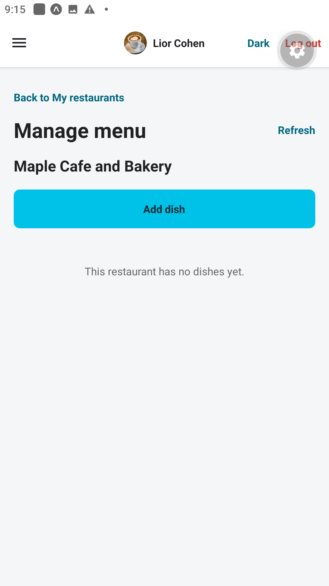

## Restaurant deletion and website owner changes

The owner deleted **Maple Cafe and Bakery** in mobile. **Cancel** was checked first, then deletion was confirmed. The app returned to **My restaurants**, and Maple was no longer listed.

On the website, the owner created **Oak Bakery** with a coffee picture, the **Bakery** category and **Not promoted**, then renamed it to **Oak Cafe and Bakery**. Refreshing **My restaurants** in mobile showed the new name and picture. The following capture shows Oak after this refresh and no Maple entry; it does not show either client's creation form or the mobile deletion dialog.

On the website, the owner also added **Flat White** at ₪19.00 with category **Drinks** and a coffee picture, then edited its price to ₪21.00. The saved website view below shows **Restaurant details updated**, **Menu item updated** and Flat White at ₪21. The dish category and its picture are not visible in this capture.

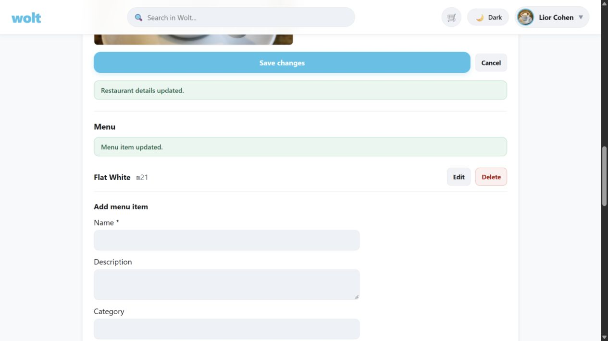

Website deletion of Flat White was attempted, but the browser tool could not answer its native confirmation dialog. The final website confirmation checks are tracked below.

## Saved profile location

In mobile, the owner changed the profile latitude from **32.0853** to **32.1**, keeping longitude **34.7818**, and saved it. The profile then displayed **Saved location: 32.1, 34.7818** and a green success message. This capture confirms the saved values and feedback; it does not show the nearby-restaurants list after the change.

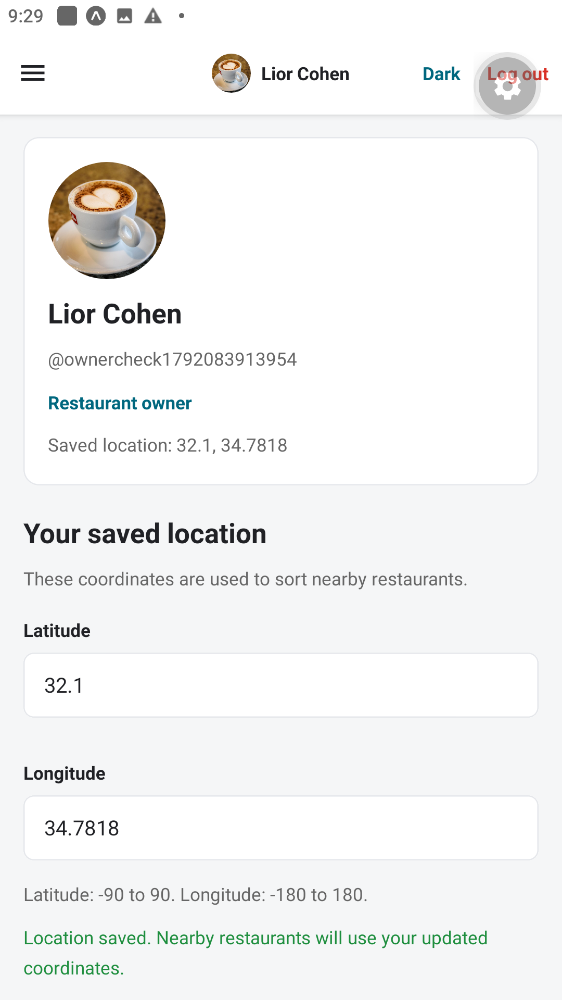

## Website cart and order in the Compose environment

The website was also checked against the separate Compose environment on port **3002**. The customer **Dana Amir** added one **Classic Pizza** from **Olive Pizza**. The cart displayed quantity **1**, a total of **₪42.00**, quantity controls and **Place order**. This capture is from before submission and does not establish that this order was placed.

The customer then selected **Place order**. The website displayed a success message for **order_1792089653471_959** and a new Olive Pizza entry at **21:40:53**, with one Classic Pizza and a total of **₪42.00**. An earlier order is also visible in the history.

Expo Go was connected to the same Compose API on **3002** and Metro on **8082**. Logging in as Dana Amir and opening order history showed both Olive Pizza orders, including the new entry at 21:40:53 for ₪42.00. This native history check was observed but not captured. It verifies reading the order placed on the website, not submitting an order from mobile against Compose.

The following native capture shows the guest home in that Compose environment. **Olive Pizza** appears under **Promoted restaurants** with its picture, Pizza category and description. **All categories** is selected and **Log in** is visible. This records the loaded guest home; it does not show a search, login or checkout action.

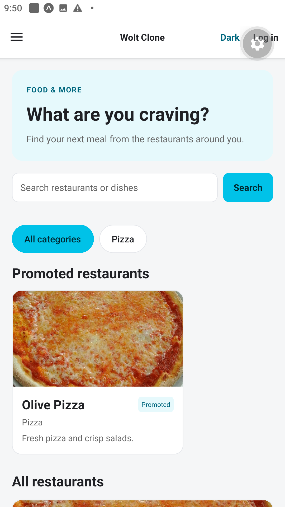

## Mobile registration validation

The registration screen was checked in Expo Go against the rebuilt Compose mobile service. Submitting an empty form displayed required-field and password feedback. The latitude and longitude messages wrapped fully within their respective columns after the layout correction.

Following user testing, password requirements now start in gray without failure marks. Submitting an invalid form displays red errors; corrected password requirements turn green. Leaving and reopening registration clears the previous validation and server errors while preserving the entered values. Eight focused component checks cover this behavior; the screenshot below still shows the state after an invalid submission.

This capture demonstrates validation only. Seven automated checks covered the registration picture chooser, including cancellation, failure and camera denial. A complete native registration was then performed in the final run below.

## Final Compose checks on 16 October

The following run used the Compose API and website on `3002` and Metro on `8082`. The latest Web profile fix was deployed before the final order checks; existing data was retained. The separate clean Docker build and persistence checks used `3003` and `8083`, as recorded in [Build and run](run.md#verification-status).

Docker Desktop shows the four application services running after recreation, together with the separate MongoDB test service. Health checks and data persistence were verified through the commands in the run guide; the screenshot itself shows running status.

### Registration and login in both clients

On the website, the fictional owner **Maya Levi** registered with a selected coffee picture, then logged in and opened the profile. The password fields are masked in the form capture.

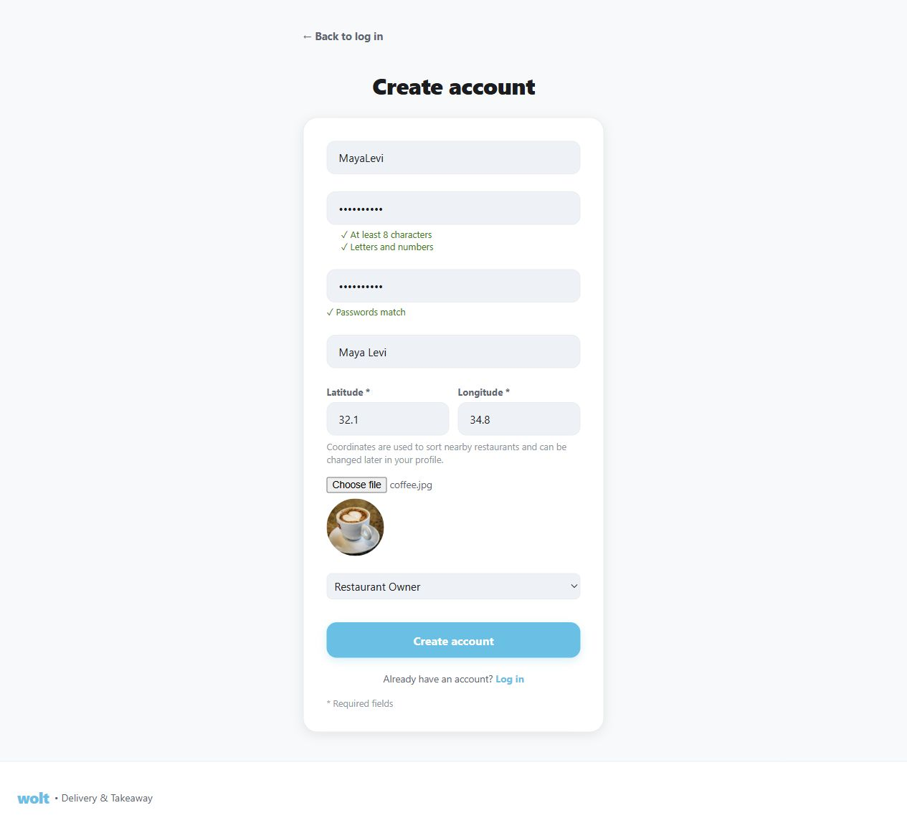

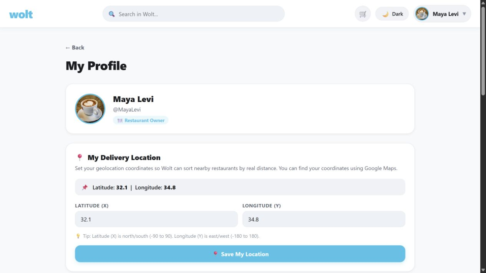

In Expo Go, **Leo Moran** selected a coffee picture through the system's individual-photo chooser while broad media access remained denied. The filled form kept password requirements gray before submission. Registration succeeded, and logging in displayed the chosen name and picture on the home screen.

### Native checkout, editing and deletion

1. Leo added one **Classic Pizza** at ₪42 and one **Garden Salad** at ₪28 from Olive Pizza. The cart showed two items and ₪70.
2. **Place order** returned `order_1792163383112_891` at ₪70 and emptied the cart.
3. In the order edit screen, pizza quantity was changed to two and the salad removed. Saving returned to history at ₪84. Reopening the details showed two pizzas at ₪42 each.
4. **Delete order → Cancel** kept the order after refresh. Confirming **Delete** removed it; refreshing history showed **No orders yet**.

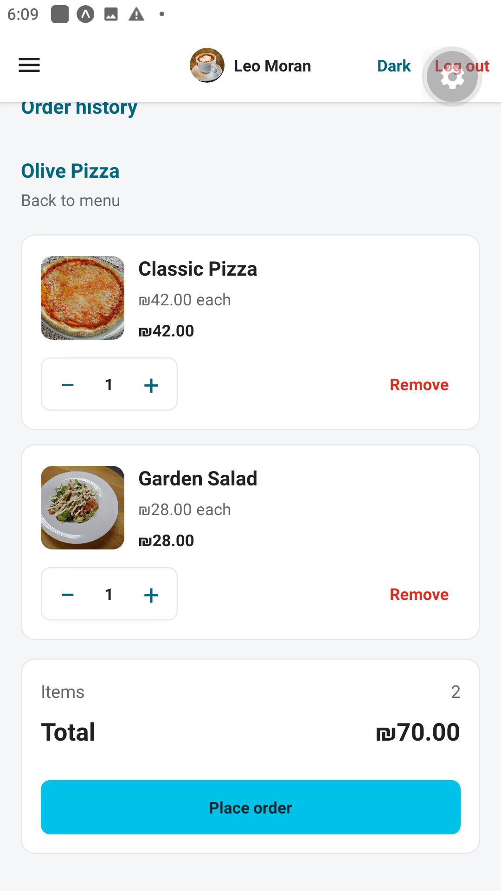

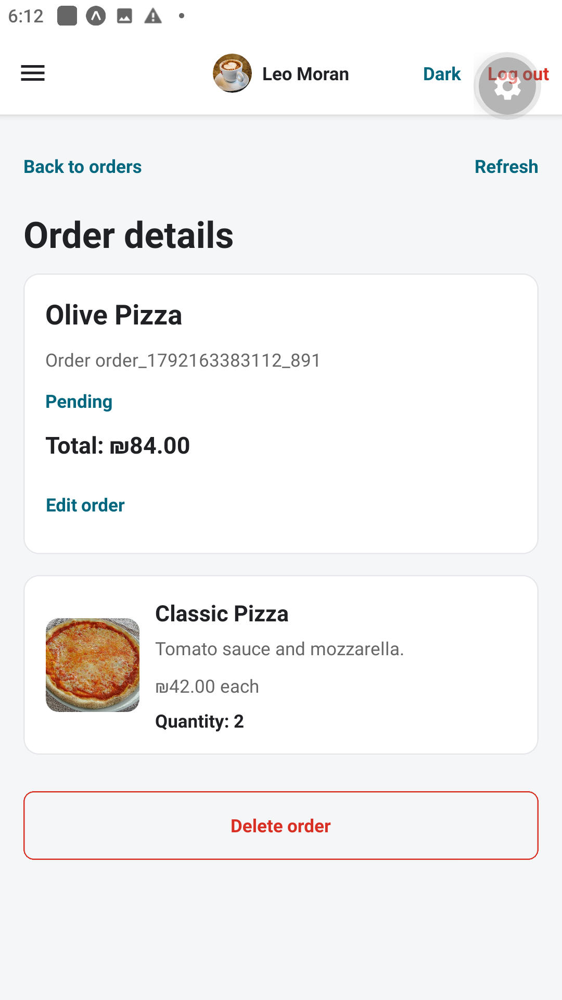

### Website owner and order checks

Maya created **Garden Cafe**, renamed it to **Garden Cafe and Bakery**, added **Cappuccino** at ₪18 and updated its price to ₪20. The website placed an order for one cup, then saved a quantity change to two. The refreshed history showed ₪40.

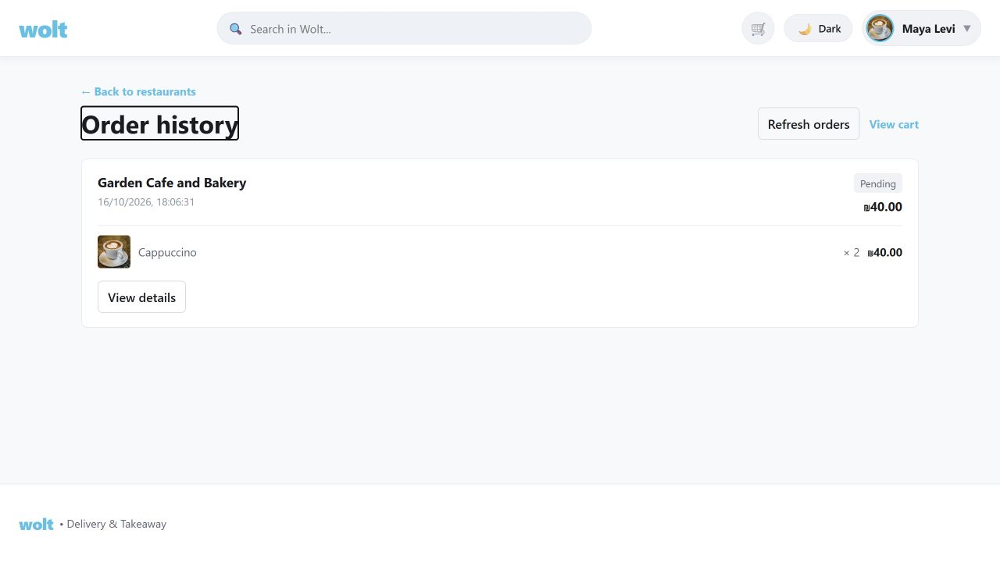

The website's order, dish and restaurant delete confirmations were handed to the user because the browser tool could not operate the native dialog. Their final results are pending. Earlier manual checks were reported as successful by the user, including creating and deleting a temporary restaurant; that report is separate from the captured checks above.
